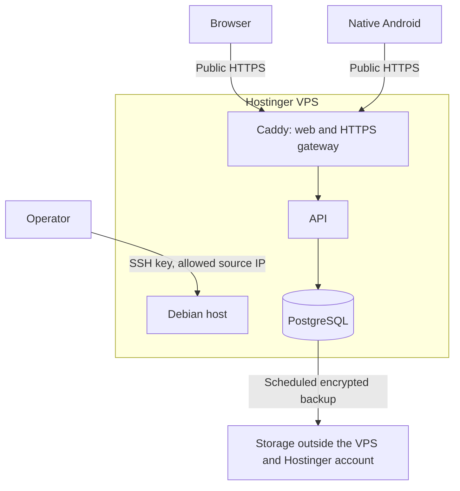

# M8: Public deployment on Hostinger VPS

Updated: 2026-10-24. M8 deploys ChordViewer to a public Hostinger VPS and proves that web and Android work independently of the development computer. Server installation, hardening, HTTPS, release packaging, backups and operating procedures are part of this milestone. The first release is live; the [dated verification](../deployment/first-deploy-2026-10-24.md) records the evidence, and the [operations runbook](../deployment/runbook.md) records the installed layout and remaining acceptance gates.

Hostinger VPS `187.124.165.121` and canonical domain `chordviewer.app` are selected. The owner confirmed secure account/recovery access, administration from this workstation, Synology backups over Tailscale as the next setup step, and `andrei.sherban@gmail.com` for alerts. Provider billing/region details, off-site transfer and alert delivery remain to be recorded/configured. The active roadmap ends at M8. Subscriptions, payments, unrestricted public signup and app-store publication remain deferred. Anyone can reach the HTTPS login page, while the operator provisions approved accounts. No client VPN is required.

The [deployment decision](../ADRs/0015-public-hostinger-deployment.md) records the scope. Local validation and environment separation remain prerequisites, and Android retains its [reviewed release-origin requirement](../ADRs/0011-development-and-release-endpoints.md).

## Deployment layout

Retain the inspected Debian 13 server with Docker Engine and Compose, as recorded in [ADR 0016](../ADRs/0016-first-public-release-boundaries.md). Caddy serves the built web application, manages public TLS certificates and proxies `/api/` to the API. Both clients use `https://chordviewer.app`; `www` redirects there and `api` remains an API alias. The API and PostgreSQL are reachable only on container networks; the database network excludes the gateway.

MIDI stays on the browser or tablet. YouTube loads on the client. A fresh deployment starts with an empty library; existing saved scores can be moved deliberately through JSON export/import. Development sessions, credentials and unsaved recovery copies stay tied to their original environment.

## 1. Confirm the server and access details

Before provisioning, record the Hostinger account owner, VPS identity, region, IP addresses, CPU architecture, tier, memory, storage, bandwidth and renewal cost. Use a dedicated server or inspect existing workloads before choosing a deployment directory or ports. Do not reinstall an occupied VPS to satisfy this plan.

Start sizing around one vCPU and 4 GB RAM, with enough disk for the OS, two releases, database growth and temporary backups. This is a planning baseline, not a measured capacity guarantee. Build images and APKs on the workstation. Compare the complete recurring cost, including domain and backup storage, with the roughly USD 10 monthly hosting target before purchasing or upgrading anything.

Confirm ownership of the application domain, DNS access, administrator source IPs, independent backup storage, an alert destination and an operator responsible for patching and recovery. Enable MFA for Hostinger, DNS and backup accounts; store recovery codes and SSH key recovery material privately outside the VPS.

The existing VPS runs Debian 13. Hostinger's dashboard provides firewall, backup and emergency recovery controls; the owner confirmed a recovery route before SSH changes. [VPS dashboard](https://www.hostinger.com/support/5726606-how-to-use-the-vps-dashboard-in-hostinger/).

## 2. Install and harden the host

Perform these steps in order and record the effective configuration in the deployment runbook.

| Step | Required work |
| --- | --- |
| Bootstrap | Retain the inspected Debian 13 installation. Apply security updates, keep a stable hostname and UTC server clock, enable time synchronization, and reboot if required. Record the OS and kernel versions. |
| Administrator | Create a named, non-root operator with sudo access and an Ed25519 SSH public key. Keep the private key passphrase-protected on the operator's device. Verify the server host-key fingerprint using the provider recovery route. |
| SSH hardening | First prove key login and sudo in a second session while retaining the initial session. Then disable remote root login, password authentication and keyboard-interactive authentication; restrict SSH to the operator account. Check effective settings, including image/cloud-init overrides, validate configuration before reload, and prove a fresh connection still works. |
| Recovery | Record and verify Hostinger's emergency recovery procedure. Restrict SSH source addresses only after confirming an administrator route. If the operator's address changes, update the provider allowlist before reconnecting; do not temporarily open SSH to everyone. |
| Updates | Enable automatic Debian security updates and failure reporting. Schedule reboots in an operator-controlled maintenance window. Review Docker packages, container images and application dependencies separately; OS updates do not update application images. |
| Minimal host | Remove unnecessary listeners and disable unused services. Administer through SSH without a public database or container-management panel. Bound system logs and monitor free space. |
| Container runtime | Install Docker Engine and the Compose plugin from Docker's official apt repository. Enable startup on boot and record versions. Limit Docker administration to trusted operators: daemon access is effectively root access. Never expose the Docker API or mount its socket in application containers. |
| Deployment storage | Create `/srv/chordviewer` for versioned releases and restricted configuration. Keep secrets outside Git and images, readable only by the required operator/service identities. Generate independent database and authentication secrets for this deployment. |

Validate the effective SSH configuration against Debian's [sshd_config reference](https://manpages.debian.org/trixie/openssh-server/sshd_config.5.en.html). Docker uses its [official Debian repository](https://docs.docker.com/engine/install/debian/). The runbook records the installed maintenance services and effective settings.

## 3. Configure network access and HTTPS

Configure the host firewall with explicit inbound rules for both IP families. Activate Hostinger's managed firewall as an additional layer when provider access is available; its configuration remains unverified. Allow established return traffic and necessary network-control traffic, including ICMPv6, so filtering does not break IPv6 or path MTU discovery.

| Service | Allowed access |
| --- | --- |
| TCP 443 | Public access to the Caddy HTTPS gateway. |
| TCP 80 | Public access for certificate validation and redirection to HTTPS. Application credentials are sent only over HTTPS. |
| TCP 22 | SSH access only from the confirmed operator source addresses. |
| API, PostgreSQL and administration ports | No public access. Do not publish API port 3000, database port 5432, Caddy administration or Docker API ports. |
| Other inbound traffic | Deny it unless a documented operational requirement needs a narrow exception. |

Permit outbound DNS, time synchronization, package/image retrieval, certificate issuance, backup transfer and monitoring delivery as required. Record any outbound restrictions and verify they do not prevent updates or renewal. Publish only gateway ports from Compose. Keep Docker's firewall integration enabled and inspect forwarding rules for the installed backend; UFW alone does not protect Docker-published ports. Test from an unrelated external network against IPv4 and IPv6, including after a reboot. [Hostinger firewall](https://www.hostinger.com/support/8172641-how-to-use-a-managed-vps-firewall-at-hostinger/), [Docker firewall behavior](https://docs.docker.com/engine/network/packet-filtering-firewalls/).

Point the domain's A record at the VPS. Add an AAAA record only after IPv6 routing and filtering pass; an unpublished IPv6 address must still be protected. Configure Caddy for the exact hostname, persist its certificate state and verify automatic issuance and renewal. Reject unexpected hostnames, serve no application on a raw-IP fallback, and redirect HTTP to the canonical HTTPS origin. Check certificate validity and the full chain from both clients. [Caddy automatic HTTPS](https://caddyserver.com/docs/automatic-https).

Apply security headers deliberately: prevent MIME sniffing and framing of the app, use a restrictive referrer policy, and define a content-security policy that permits the required YouTube player. Introduce HSTS after the HTTPS checks pass; do not preload or include unrelated subdomains. Verify that these settings preserve tutorial playback and browser MIDI.

## 4. Prepare the application release

The release now has a distinct HTTPS configuration, Secure cookies, closed enrollment, a packaged web gateway and a reviewed Android origin. The development profile remains separate. The following requirements define the release boundary and continuing operational obligations.

| Area | Required change |
| --- | --- |
| Deployment configuration | Add an explicit deployed HTTPS profile with one canonical origin and an exact trusted-origin list. Reject mixed development/release settings, wildcard origins and missing secrets. Preserve the local development profile. |
| Authentication | Use Secure, HttpOnly, SameSite browser cookies. Preserve origin checks for cookie writes, signed native sessions, expiry/revocation and account isolation. Confirm HTTPS base URLs and refuse redirects to other origins. |
| Enrollment and recovery | Disable public signup in the deployed API and hide it in both deployed clients. Provide an operator-only account provisioning and password-reset procedure with identity verification and secure credential handoff; revoke sessions on reset. An email allowlist without proof of ownership is insufficient. Self-service email verification/recovery remains deferred. |
| Proxy and abuse controls | Strip caller-supplied forwarding and internal client-IP headers at the gateway. Trust only the verified gateway path in the API, then derive rate-limit identity from that path. Test spoofing, multiple clients and shared-IP use; never enable blanket proxy trust. Keep login throttling, request size/time limits, per-account quotas and explicit deployment-wide account/storage bounds. |
| Web gateway | Produce a versioned Caddy/web image with built assets, SPA navigation and third-party notices. Preserve API status codes, multiple Set-Cookie headers, native session headers and retry headers. Do not cache authenticated API responses. Keep detailed health diagnostics private. |
| Compose release | Add a separate release bundle with pinned, architecture-compatible image identities, health checks, restart policies, bounded CPU/memory/logs and persistent database/certificate volumes. Retain non-root processes where supported, read-only application filesystems, dropped capabilities and no-new-privileges. Give only the gateway the privileges needed to bind its ports. |
| Database and secrets | Keep application credentials separate from bootstrap/migration administration. Run migrations deliberately before a compatible application starts, and keep administrative credentials out of the long-running API. Document secret rotation and session consequences. |
| Android | Configure the reviewed domain and produce a signed, non-debuggable APK. Verify cleartext and development endpoint rejection. Preserve the signing key privately off-server, increment version codes and test installation over an earlier release signed with that key. Distribute the APK over HTTPS to approved users; app-store publication is deferred. |
| Operations | Add a Linux deployment/update/backup/restore runbook and scripts with runtime diagnostics. Document release IDs, checksums, configuration names and rollback steps without embedding secrets. |

Build and validate the release locally before transferring an image archive and checksums over SSH. Rehearse the HTTPS gateway and real cookie/bearer authentication with isolated data. Scan release dependencies and images, resolve exploitable high-severity findings, and review authentication, network exposure and secret handling before enabling real accounts.

## 5. Backups, monitoring and maintenance

Schedule a consistent PostgreSQL dump nightly and before each update. Encrypt completed bundles and transfer them to storage outside the VPS and Hostinger account, with seven daily and four weekly recovery points initially. Separate deletion/retention authority from the VPS backup writer where the destination supports it. Alert on failed transfers and backups older than 26 hours. Keep decryption keys recoverable outside both the VPS and the backup writer's credentials.

A backup bundle includes the database dump, checksums, schema version, exact image identities or archives, and Compose/bootstrap configuration. Escrow required secrets and Android signing material separately. Copying a live database directory is not the backup procedure. Unsaved device-local drafts are not included. Hostinger snapshots are an additional pre-update aid; verify the purchased retention and restore behavior, and do not use a whole-server restore for a routine rehearsal because it overwrites the active server. [Hostinger backups](https://support.hostinger.com/en/articles/1583232-how-to-back-up-or-restore-a-vps).

Restore a bundle retrieved from the independent destination into a fresh isolated project and volume. Verify identities, scores, revisions, Library metadata and Trash, and sign in from both clients through an isolated HTTPS endpoint. Also prove that the runbook can rebuild the service on a clean host without files from the original VPS. Proposed recovery targets are no more than 24 hours of saved-data loss and restoration within four hours; measure both in the rehearsal and revise the targets if necessary.

Before an update, verify the backup and retain the previous release. Roll back images only when the database schema is compatible; otherwise restore the matching backup into a fresh volume and switch deliberately, accounting for subsequent writes. Never delete the active volume as part of an update. Verify restart policies and schedules after a server reboot.

Set up external HTTPS availability monitoring and alerts for certificate expiry, failed backups, low disk space, memory pressure, repeated container restarts and abnormal authentication failures. Keep logs bounded and redact passwords, tokens, cookies and score contents. Test an alert end to end. Record the operator's patch/reboot cadence and incident procedure: isolate access, preserve evidence, rotate compromised credentials, revoke sessions and restore a known-good release.

## Implementation order and completion evidence

| Stage | Completion evidence |
| --- | --- |
| 1. Preflight | Record the VPS, domain, approved cost, administrator/recovery access, backup destination and alert owner. |
| 2. Local release rehearsal | Pass production-configuration, enrollment, HTTPS cookie/bearer, proxy-spoofing, origin rejection, quota and account-isolation checks through the packaged gateway. |
| 3. Server installation | Record Debian/Docker versions, effective SSH settings, firewall rules, running services and external IPv4/IPv6 scans. Verify only the intended ports are reachable and repeat after reboot. |
| 4. Public deployment | Install the release with fresh secrets and data. Confirm browser and signed Android sign-in, create/save/reopen, Library, Practice, tutorial and MIDI from home and a separate remote network, with the PC backend stopped and no VPN. |
| 5. Failure and update checks | Verify network loss, local recovery, cross-device conflicts, session expiry/revocation, container replacement and server reboot. Confirm saved data and metadata survive; rehearse a compatible rollback. |
| 6. Recovery and handover | Restore an independent backup, demonstrate clean-host recovery, measure recovery time and resource use, and observe at least 24 hours of normal operation including a successful scheduled backup and delivered test alert. Publish the runbook and dated M8 verification record. |

M8 is complete only when the deployed service passes these gates. Include product tests for changed authentication, enrollment and proxy behavior, plus real browser/native acceptance. Development-only helpers retain runtime diagnostics without dedicated automated test suites. First deployment does not close the NAS backup, alert delivery, hardware/network acceptance or observation gates; use the dated verification record rather than treating this checklist as completed evidence.
