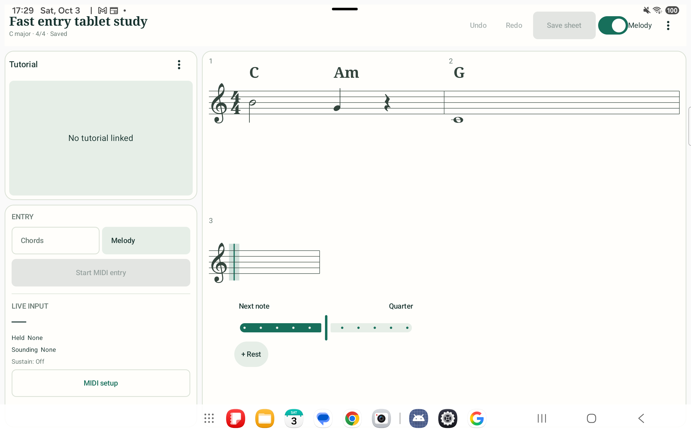
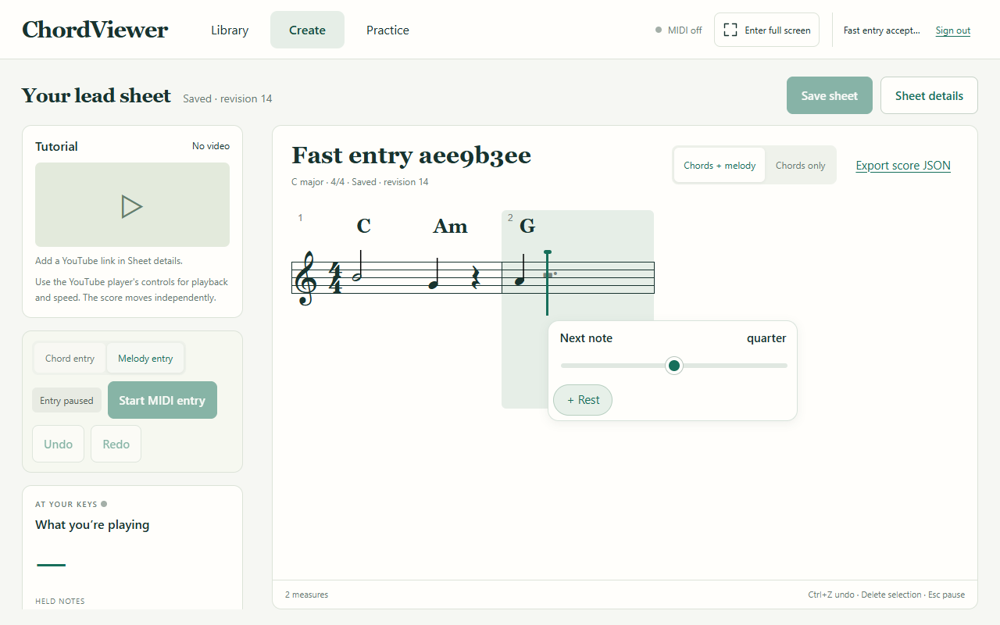

# Create view visual guide

The [entry plan](../../create-entry-plan.md) describes the current controls and acceptance criteria. These screenshots show the implemented interface with disposable test music.

## Complete chord dialog

The selected design is [complete-chord-dialog.png](complete-chord-dialog.png). The implemented native popup opens directly at a tapped chord or append marker with an Add chord/Edit chord heading. Root/type/bass, duration, extensions, alterations and advanced construction actions share one popup. Rare choices expand inside it; constrained sizes and larger text scroll with persistent actions. [Verification and real screenshots](../../chord-dialog-verification.md) distinguish application evidence from the earlier visual reference.

## Direct stave entry

- Tap the visible entry line in the score to place the next note, or drag vertically before releasing.
- Drag an existing note to change its pitch. Use the single slider beside the entry point to change its duration and shift later melody.
- Use the nearby Rest control to insert a rest or replace the selected note. Delete removes the note and closes its duration.
- Selecting a tied fragment selects the entire note. Automatic rests fill incomplete measures.

## Browser layouts

The [narrow browser screenshot](../../evidence/fast-entry-web-narrow.png) shows how the score reflows on a small screen.

The [verification record](../../fast-entry-verification.md) lists the tested interactions and remaining manual checks.
